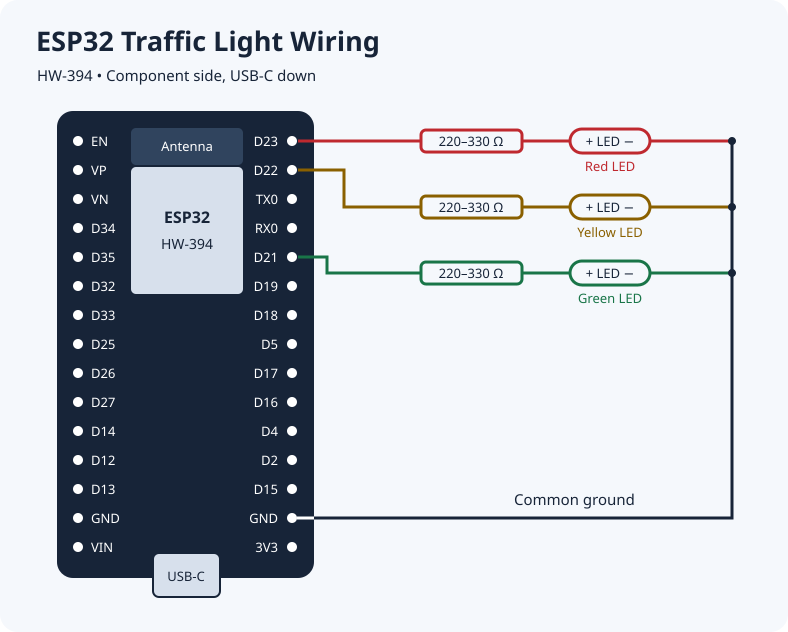

# Project 02 · ESP32 Traffic Light

Three external LEDs repeat a 14-second traffic light cycle on an ESP32 HW-394.

| LEDs on | Duration |
| --- | --- |
| Red | 5 s |
| Red and yellow | 2 s |
| Green | 5 s |
| Yellow | 2 s |

## Video Tutorial

[Watch the tutorial on YouTube](https://youtu.be/65SfjZVwT-Q)

## Parts

- ESP32 HW-394 (30-pin, USB-C)
- One red, one yellow, and one green LED
- Three 220–330 Ω resistors, one per LED
- Breadboard, jumper wires, and a USB-C data cable

## Wiring

Disconnect USB power before wiring. Face the component side of the board with the USB-C port at the bottom. Count down the right header from the antenna end.

| Position on right header | Board label | Connection |
| --- | --- | --- |
| 1st from top | D23 (GPIO23) | Red LED through a 220–330 Ω resistor |
| 2nd from top | D22 (GPIO22) | Yellow LED through a 220–330 Ω resistor |
| 3rd from top | TX0 | Leave open |
| 4th from top | RX0 | Leave open |
| 5th from top | D21 (GPIO21) | Green LED through a 220–330 Ω resistor |
| 2nd from bottom, just above 3V3 | GND | Common return for all three LEDs |

```text
D23 ── [220–330 Ω] ── (+) Red LED    (−) ──┐
D22 ── [220–330 Ω] ── (+) Yellow LED (−) ──┼── GND
D21 ── [220–330 Ω] ── (+) Green LED  (−) ──┘
```

Connect each resistor between its GPIO pin and the LED anode (+, usually the longer lead). Connect all three cathodes (−, usually the shorter lead) to the same ground rail, then connect that rail to the ESP32 GND pin.



## Upload

1. Open `02-traffic-light.ino` in Arduino IDE.
2. Install **esp32 by Espressif Systems** from Boards Manager if needed.
3. Connect the ESP32 by USB, select **ESP32 Dev Module** and the board's serial port, and upload.
4. Check that the cycle starts with red and repeats in the order shown above.
